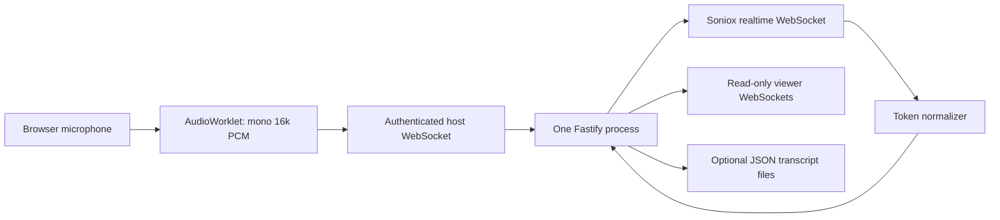

# Architecture

LinguaRoom is a modular monolith. `apps/server/src/main.ts` starts one Fastify server serving `dist/web`, authenticated HTTP APIs and WebSocket upgrades. `apps/web` is a Vite-built TypeScript interface without React, external fonts, analytics or CDNs. `packages/shared/protocol.ts` defines normalized events and validated session inputs.

The SpeechProvider interface is the extension boundary. Soniox JSON stays inside its adapter. The production application has only Soniox; an explicitly labeled test mock lives in tests. One active meeting and one audio-producing host socket are supported per process. No paid connections are created for viewers.

Final token deltas append once to an active run. Provisional suffixes are reconstructed per response. Source/translation, speaker and language transitions produce independent caption runs. Endpoint markers seal runs. Stable IDs and monotonically increasing revisions update existing rows. Disappearing provisional runs emit empty updates. Finalized runs are never replaced by provisional events. The normalizer retains only active tokens; runs split after 512 committed tokens even without endpointing. Server transcript retention is capped at 10,000 runs.

Browser PCM frames are 100ms/3,200 bytes at 16kHz. A streaming weighted resampler carries phase across render quanta and writes explicit little-endian signed 16-bit samples. Its simple box filter favors portability; it is not a studio-quality resampler. Transport buffers are bounded at one second in the browser and five seconds at the provider. Behind connections drop audio and report loss; they do not build an unbounded replay queue.

Events include schemaVersion, sessionId, eventId, timestamp, providerId and a revised segment with original/translated text, languages, speaker, partial/final state and source audio timing when available. Snapshot replay on reconnect replaces state and prevents duplicate subtitles. The frontend retains viewer access only in page memory after removing the URL fragment.

Metrics measure local elapsed time from the first submitted audio to the first result/final result, provider processed audio offsets, queued bytes, submitted/dropped bytes, update count, memory and uptime. These do not establish exact speech-to-subtitle latency across devices. Targets of first captions around 2s and p95 below 4s are goals requiring measurement under real conditions.

Persistence writes JSON on session stop, shutdown or speaker edits when enabled; it is not crash-safe continuous recording. Saved sessions are accessible only through host APIs. Audio is never written to disk.

## Standalone browser capture

The default standalone / GitHub Pages app sends the same 16 kHz, mono, signed 16-bit little-endian PCM as the server version, directly to Soniox. Its startup follows the user-verified Termux reference: create and resume the AudioContext during the Start gesture, acquire the microphone, await the original resume promise, then load and connect the AudioWorklet. It additionally waits for an actual PCM frame before connecting to Soniox. It does not use MediaRecorder or compressed container headers.

A connected standalone WebSocket initially displays “Waiting for audio”. The app displays “Live” only after Soniox reports processed audio or returns caption segments. Settings → Audio diagnostics distinguishes captured PCM chunks/bytes and input peak level from submitted chunks/bytes and Soniox processing progress. A health check reports stalled capture or missing processing confirmation without automatically opening another paid session.

Provider shutdown retires timed-out sockets so their late callbacks cannot stop a newer session. Duplicate stop calls share cleanup, and a new provider connection waits for that cleanup. Each page reuses one AudioContext and registered worklet module. Each meeting acquires a fresh microphone stream and processor. Stop releases the tracks, stops the processor, closes its message port, disconnects the full graph, and suspends the reusable context. Duplicate stops share cleanup, and controls prevent starting during shutdown. Page disposal closes the context with a bounded wait.

Audio diagnostics are populated before a room exists and refreshed on startup progress, errors, and provider updates. The visible build identifier comes from the deployed commit so a cached client can be identified. Diagnostics include context/start counts and audio counters, never API keys. Remembered keys only prefill the input; they do not restore microphone or provider state.
