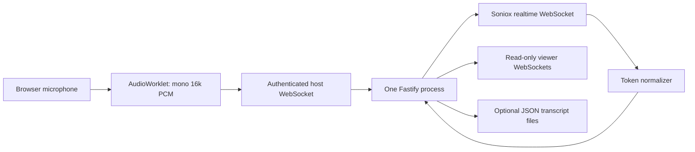

# Architecture

LinguaRoom is a modular monolith. `apps/server/src/main.ts` starts one Fastify server serving `dist/web`, authenticated HTTP APIs and WebSocket upgrades. `apps/web` is a Vite-built TypeScript interface without React, external fonts, analytics or CDNs. `packages/shared/protocol.ts` defines normalized events and validated session inputs.

The SpeechProvider interface is the extension boundary. Soniox JSON stays inside its adapter. The production application has only Soniox; an explicitly labeled test mock lives in tests. One active meeting and one audio-producing host socket are supported per process. No paid connections are created for viewers.

Final token deltas append once to an active run. Provisional suffixes are reconstructed per response. Source/translation, speaker and language transitions produce independent caption runs. Endpoint markers seal runs. Stable IDs and monotonically increasing revisions update existing rows. Disappearing provisional runs emit empty updates. Finalized runs are never replaced by provisional events. The normalizer retains only active tokens; runs split after 512 committed tokens even without endpointing. Server transcript retention is capped at 10,000 runs.

Browser PCM frames are 100ms/3,200 bytes at 16kHz. A streaming weighted resampler carries phase across render quanta and writes explicit little-endian signed 16-bit samples. Its simple box filter favors portability; it is not a studio-quality resampler. Transport buffers are bounded at one second in the browser and five seconds at the provider. Behind connections drop audio and report loss; they do not build an unbounded replay queue.

Events include schemaVersion, sessionId, eventId, timestamp, providerId and a revised segment with original/translated text, languages, speaker, partial/final state and source audio timing when available. Snapshot replay on reconnect replaces state and prevents duplicate subtitles. The frontend retains viewer access only in page memory after removing the URL fragment.

Metrics measure local elapsed time from the first submitted audio to the first result/final result, provider processed audio offsets, queued bytes, submitted/dropped bytes, update count, memory and uptime. These do not establish exact speech-to-subtitle latency across devices. Targets of first captions around 2s and p95 below 4s are goals requiring measurement under real conditions.

Persistence writes JSON on session stop, shutdown or speaker edits when enabled; it is not crash-safe continuous recording. Saved sessions are accessible only through host APIs. Audio is never written to disk.
